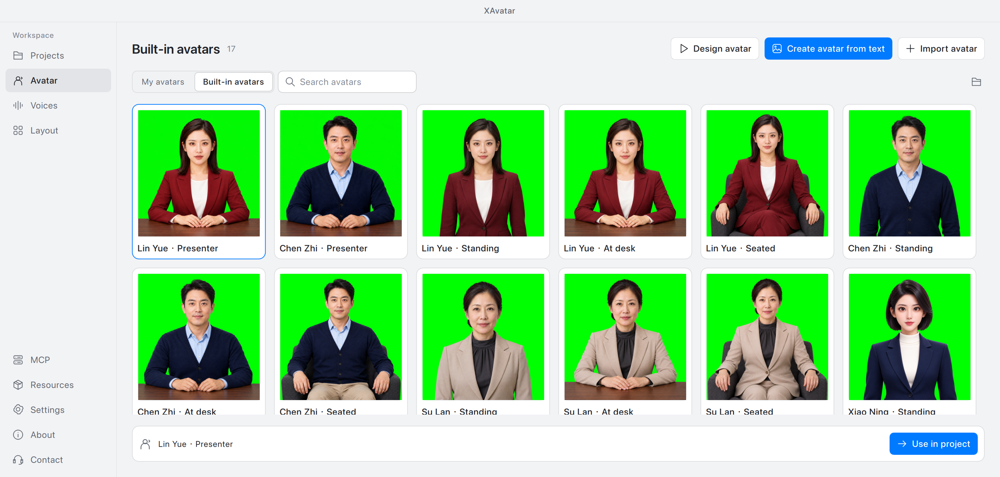
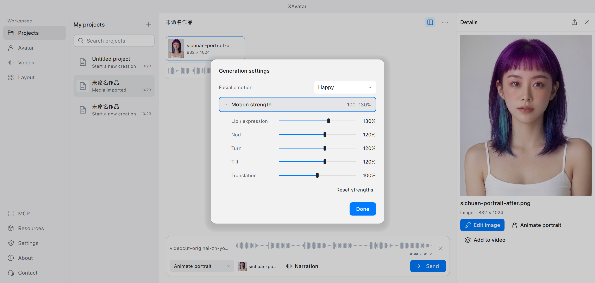
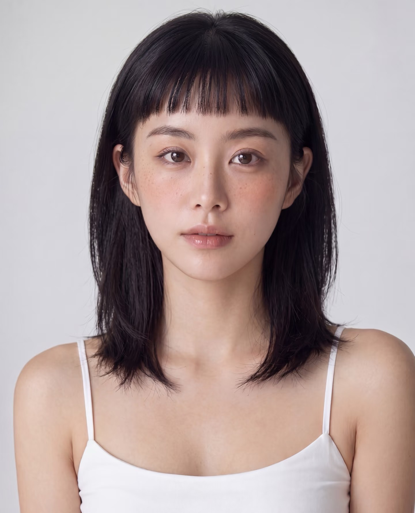
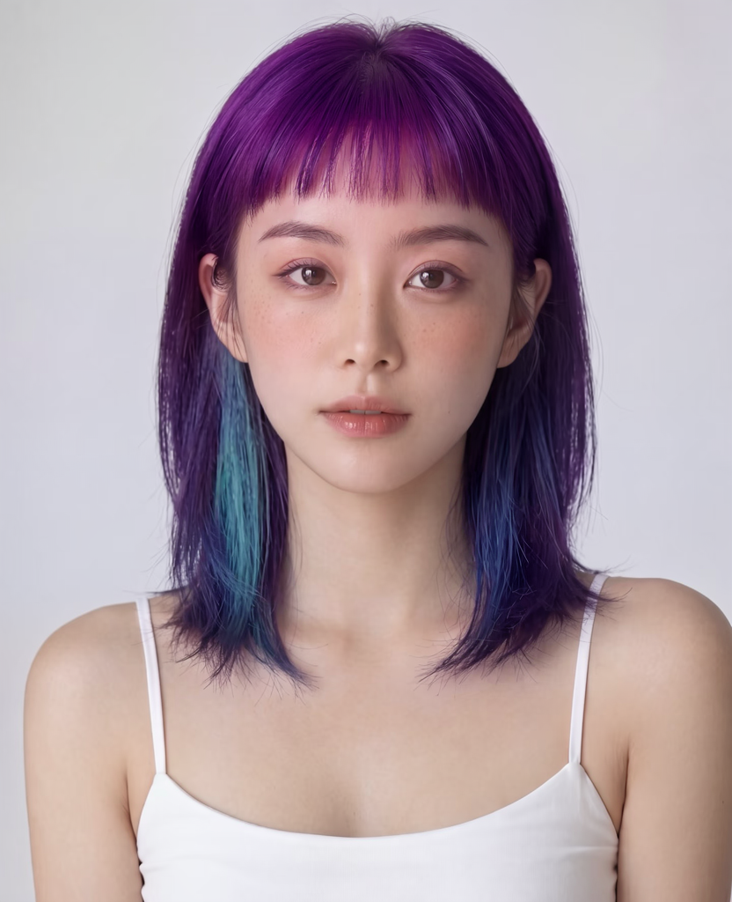

# XAvatar · 新身数字人

[简体中文](README.md) · **English**

A local AI desktop app for creating images, voices, talking avatars, and finished videos through conversation.

## Features

| Feature | What you can do |
| --- | --- |
| Images | Generate from text, edit whole images, use FlowEdit to preserve appearance, or repaint brushed/selected regions |
| Composition | Arrange objects on the canvas; start with 21 editable layout presets |
| Avatars | Create portraits from images or text, import portraits, and animate them with speech or recordings; 17 built-in portraits |
| Voices | Text-to-speech, voice design, recording import and voice cloning, emotion and dialect controls; built-in voices and 20 voice-design templates |
| Sound effects | Generate ambient sounds and effects from text, preview, and save |
| Video | Combine images, video, and audio; adjust tracks and framing; export MP4 |
| Works | Multiple conversations, search, rename, duplicate, save, remove and restore; preview and export media |
| Resources | First-run guidance, multiple-resource selection, resumable downloads, automatic source selection, verification and cleanup; Q4 images by default |
| Agents / MCP | Connect local or LAN agents to manage works, generate content, upload/read media, and inspect tasks and resources |
| Desktop | Chinese/English, light/dark appearance, adjustable three-panel workspace, diagnostic-log export; version checks and community-edition updates with restart |

## Screenshots

| Projects and images | Voice design and templates |
| --- | --- |
|  |  |

| Avatar library | Facial emotion and motion strength |
| --- | --- |
|  |  |

| Composition templates | Creative resources |
| --- | --- |
|  |  |

## Portrait editing: before and after

| Before · original black hair | After · purple and cyan hair |
| --- | --- |
|  |  |

## Talking-avatar demos

Both videos include sound. The left side shows the official model; the far-right optimized result requires the App Store version. GitHub builds use the official model.

**Multiple avatars · 84 seconds**

https://github.com/user-attachments/assets/c8c14e41-5ce8-4330-bbd6-d52f6e8f06cb

**Video portrait · 20 seconds**

https://github.com/user-attachments/assets/cefbd02c-c2e2-4b03-85a7-4597a5fbbea8

[Download original video 1](assets/showcase/avatar-demo-01.mp4) · [Download original video 2](assets/showcase/avatar-demo-02.mp4)

## Download

[**Get installers, release notes, and checksums**](https://github.com/425776024/MOSS-Image-Qt/releases)

| Platform | Requirements | Installation |
| --- | --- | --- |
| macOS | Apple Silicon (M1 or later), macOS 15+ | Download a notarized DMG and drag the app into Applications |
| Windows | Windows 10 1903+ / 11, x64 | Run `XAvatar-…-Setup.exe`, then launch from the desktop or Start menu |

No Python installation is required. Models download on demand and are not bundled. GitHub builds use the original official talking-avatar model. See each release for Windows GPU compatibility and validation coverage.

## Get started

1. Select the resources you need on first launch, or download them later under **Resources**.
2. Open **Projects**, describe your idea, and choose image, avatar, speech, sound effects, or video from the task menu beside the composer.
3. Pick built-in resources or create your own under **Avatar**, **Voices**, and **Layout**, then use them in a project.

On the voice-design page, selecting a template fills the name, voice description, and preview script. Enable MCP manually in the app, then copy its connection instructions to your agent.

## Documentation and examples

[Build and run](docs/build.md) · [Mac packaging and notarization](docs/macos-release.md) · [Windows build and validation](docs/windows-release.md) · [MCP integration](docs/mcp.md) · [Diagnostic logs](docs/diagnostics.md)

[Model management](docs/model-management.md) · [Talking-avatar model notes](docs/ditto-default-model.md) · [Model catalog](config/models.json) · [Image-editing guide and examples](vendor/moss-flowedit/README.md) · [Screenshots](assets/screenshots/en)

Image editing regenerates pixels and cannot guarantee unchanged identity or untouched regions. Third-party code, models, and media retain their own licenses; see [attribution](THIRD_PARTY.md). Original code is licensed under [MIT](LICENSE).
