# XAvatar / 新身数字人

[简体中文](README.md) · **English**

A local AI creation app for Apple Silicon Macs and Windows x64 PCs. Create images, speech, and talking-avatar videos through conversation.

[**Downloads, release notes and checksums**](https://github.com/425776024/MOSS-Image-Qt/releases)

macOS supports **Apple Silicon (M1 or later) and macOS 15+**, with DMG and App ZIP packages. See each release for its signing and notarization status. No Python installation is required; models download on demand.

The Windows test preview targets **Windows 10 1903+ / Windows 11, x64**, with Vulkan / DirectML backends. Extract the complete portable ZIP and run `MossStudio.exe`; no Python installation is required, and models download on demand. Full GPU inference, desktop interaction and export still need real-PC validation. Run the included `test_windows.cmd` for an initial diagnostic report.

Every push to `public-release` automatically builds both platforms. Find current development packages in successful [macOS Actions](https://github.com/425776024/MOSS-Image-Qt/actions/workflows/macos.yml?query=branch%3Apublic-release+event%3Apush) and [Windows Actions](https://github.com/425776024/MOSS-Image-Qt/actions/workflows/windows.yml?query=branch%3Apublic-release+event%3Apush) runs under Artifacts. Development builds may differ from published Releases.

## Feature preview

Generate images through conversation, transform an existing image with a prompt, paint over selected areas to edit, and drag objects to guide composition. Design or clone a voice, animate a portrait, generate sound effects, then combine media and export an MP4.

| Image generation | Brush inpainting | Layout composition |
| --- | --- | --- |
| <a href="assets/screenshots/en/studio.png">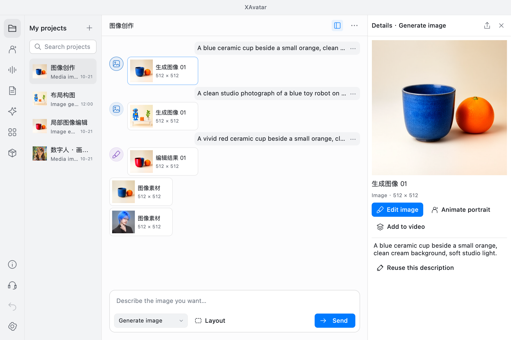</a> | <a href="assets/screenshots/en/image-edit.png">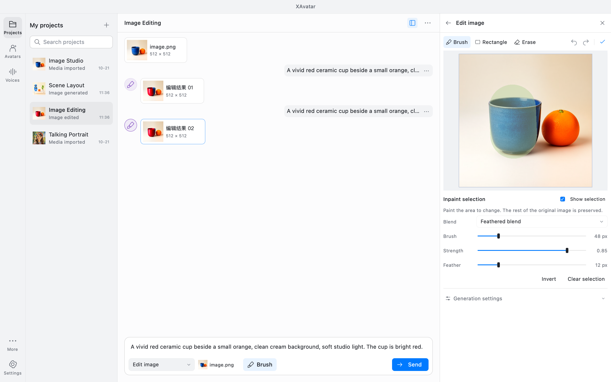</a> | <a href="assets/screenshots/en/layout.png">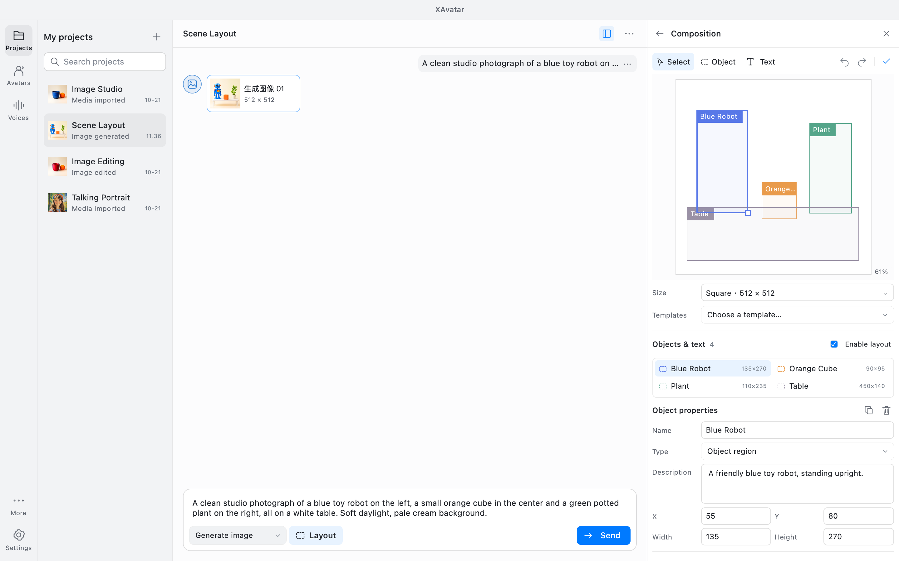</a> |

| Talking avatars | Voice design |
| --- | --- |
| <a href="assets/screenshots/en/avatar.png">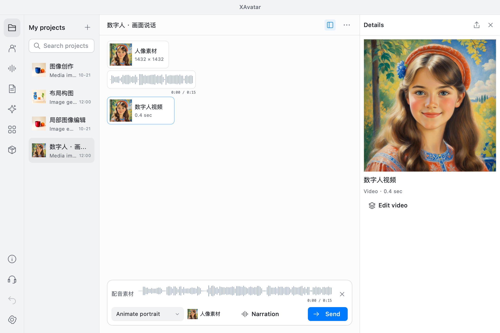</a> | <a href="assets/screenshots/en/voice-design.png">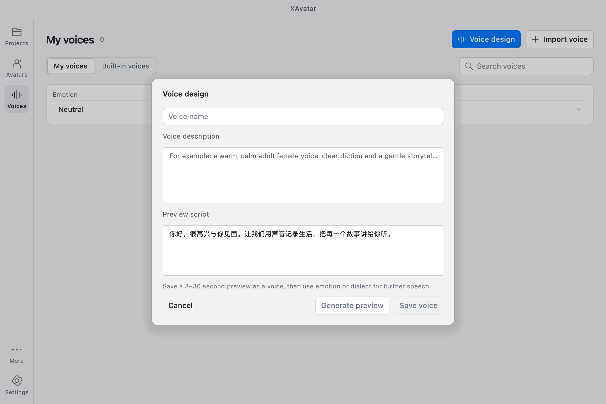</a> |
| **Sound effects** | **Video composition** |
| <a href="assets/screenshots/en/sfx.png">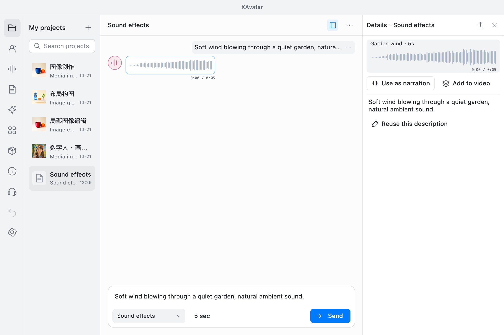</a> | <a href="assets/screenshots/en/video-pack.png">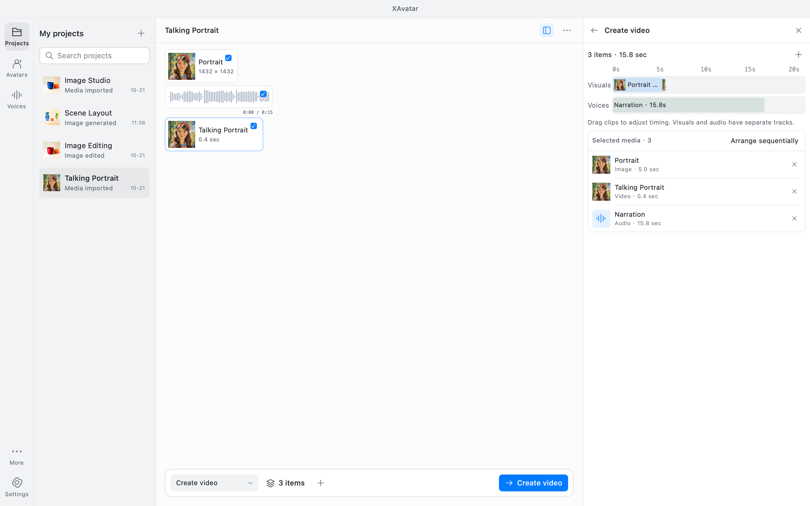</a> |

Screenshots show the current development UI; the published preview build may differ. Click any screenshot to view it at full size. [All English screenshots](assets/screenshots/en) · [中文截图](assets/screenshots/zh-Hans)

## Image editing examples

### Image to Image

In **Edit Image**, choose **Whole Image**, import an image, and open **Image to Image**:

- **Preserve appearance**: describe the source, then describe the complete edited image in the conversation composer. FlowEdit aims to retain features and composition without painting a selection.
- **Free redraw**: describe the new image using the existing image-to-image method. Higher strength usually changes more of the image.

**Selection** still provides brush and rectangular inpainting.

The two edits independently start from the same source: hair color only, and hair color with a necklace, earrings and nose ring. Both use the existing MOSS Q4_K weights at 768×1024, 28 steps, CFG 3, seed 42 and strength about 0.71 (20 FlowEdit steps), taking about 63 seconds each on an RTX 3090. No extra model, mask, feathering or source-pixel compositing is used. This example stays closer to the source than ordinary image-to-image, but skin tone and details still change; identity and unchanged outside pixels are not guaranteed.

Source description, method and strength are saved with each work. Older works retain their previous free-redraw behavior. Rebuild both the app and image engine to use this feature; published preview packages may not include it yet. See [implementation, parameters and limitations](vendor/moss-flowedit/README.md).

The real inference results below use the same source with a prompt for blue-purple crystal lettering: original, strength 0.55, and strength 0.85. Higher strength changes the material and floral decorations more visibly while retaining readable text and the two-row composition in this example.

[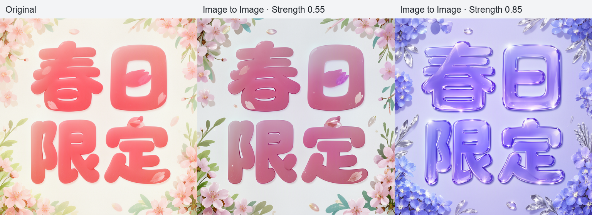](assets/showcase/image-to-image-comparison-en.png)

Generated with MOSS Q4_K at 768×768, 24 steps, on an RTX 3090, without feathering or source-pixel compositing. Image to Image redraws the entire image; it does not guarantee unchanged text, identity, or other details. Whole-image and selection scopes are available in the current development build; the published preview may differ.

### Selected-area editing

Replace text or edit selected regions while retaining the surrounding image and lettering style.

<table>
<tr><th width="50%">Text replacement</th><th width="50%">Local hair-color editing</th></tr>
<tr>
<td align="center"></td>
<td align="center"></td>
</tr>
</table>

## Talking-avatar demos

The optimized version combines **5,000-step fine-tuning, silent-mouth calibration, and speech-onset transitions** to improve resting mouth shapes and the transition into speech.

**The default community / GitHub download uses the original official model, corresponding to the official result on the left. The optimized result on the far right requires the app downloaded from the App Store.**

Both videos include audio. Click play to watch.

**Multiple avatars · 84 seconds**

https://github.com/user-attachments/assets/c8c14e41-5ce8-4330-bbd6-d52f6e8f06cb

**Video portrait · 20 seconds**

https://github.com/user-attachments/assets/cefbd02c-c2e2-4b03-85a7-4597a5fbbea8

[Download original video 1](assets/showcase/avatar-demo-01.mp4) · [Download original video 2](assets/showcase/avatar-demo-02.mp4)

## Resources and imports

Manage resources by task: images, avatars, speech, and sound effects. Download, verify, or remove resources as needed, and preview portraits before importing them.

| Creative resources | On-demand downloads | Portrait import preview |
| --- | --- | --- |
| <a href="assets/screenshots/en/models.png">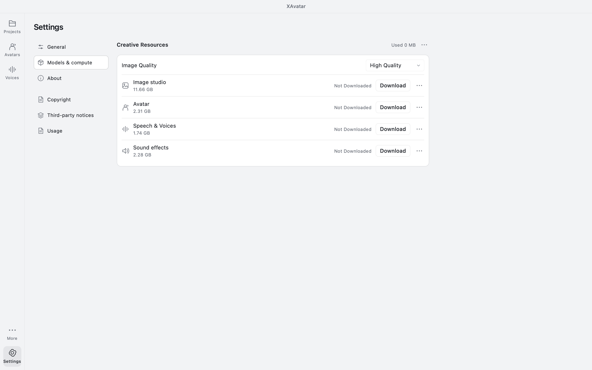</a> | <a href="assets/screenshots/en/download.png">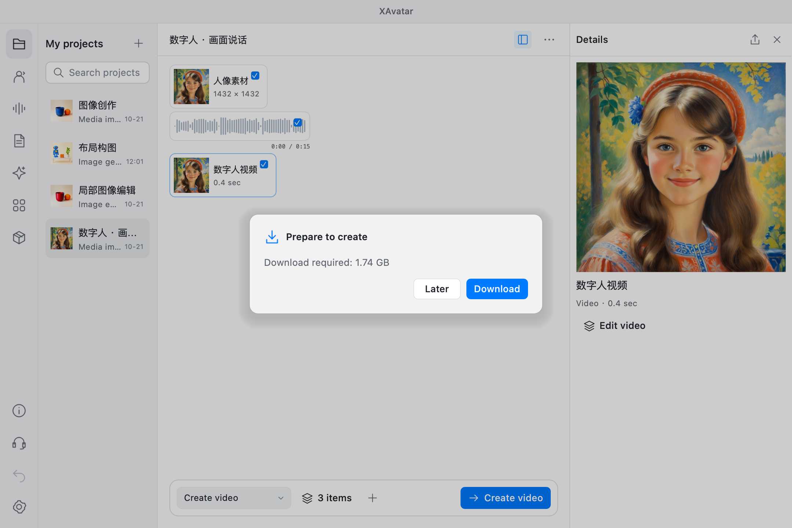</a> | <a href="assets/screenshots/en/avatar-import.png">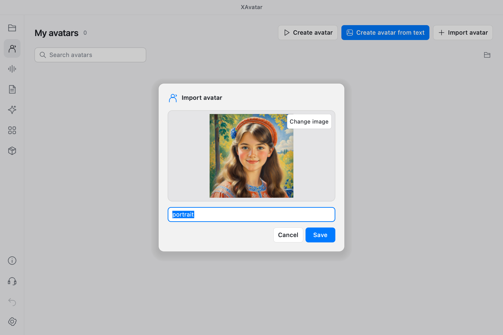</a> |

## Models

| Purpose | Model | Features / preview |
| --- | --- | --- |
| Image generation and editing | [MOSS-Image SFT GGUF](https://huggingface.co/leejet/MOSS-Image-SFT-GGUF) · Q4_K / Q8_0 | [Generation](assets/screenshots/en/studio.png), [local editing](assets/screenshots/en/image-edit.png), [layout](assets/screenshots/en/layout.png) |
| Image text encoder | [Qwen3.5-9B GGUF](https://huggingface.co/unsloth/Qwen3.5-9B-GGUF) · Q4_K_M | Image descriptions and editing instructions |
| Image decoder and tokenizer | [FLUX.2 VAE](https://huggingface.co/Comfy-Org/MOSS-Image), [MOSS-Image tokenizer](https://huggingface.co/OpenMOSS-Team/MOSS-Image-Base) | Shared image components |
| Talking avatars | [ditto-talkinghead](https://github.com/antgroup/ditto-talkinghead) | [Audio-driven portraits](assets/screenshots/en/avatar.png), silent-mouth calibration, and speech-onset optimization |
| Face detection and rendering | [YuNet](https://github.com/opencv/opencv_zoo/tree/main/models/face_detection_yunet), [LivePortrait](https://github.com/KwaiVGI/LivePortrait) | Face alignment, motion, and rendering |
| Speech and voices | [Ming-3.0 TTS 0.5B](https://github.com/inclusionAI/Ming-3.0-tts) · [GGUF Q8_0](https://huggingface.co/audio-cpp/Ming-3.0-TTS-0.5B-GGUF) | Text-to-speech, voice cloning, [voice design](assets/screenshots/en/voice-design.png), emotion, and dialect controls |
| Sound effects | [Stable Audio 3 Small SFX](https://huggingface.co/thepatch/stable-audio-3-small-sfx-GGUF) · F16 with T5Gemma | [Sound generation](assets/screenshots/en/sfx.png), [listen](#sound-effects-preview) |

Built with Qt / QML / C++. Pinned model revisions, hashes, and sources are listed in the [model catalog](config/models.json).

[Design guidelines](DESIGN.md) · [Build and run](docs/build.md) · [macOS packaging and notarization](docs/macos-release.md) · [Model management](docs/model-management.md) · [Ditto model notes](docs/ditto-default-model.md) · [Third-party sources](THIRD_PARTY.md)

The Windows preview is publicly available in [Releases](https://github.com/425776024/MOSS-Image-Qt/releases/tag/win-0.1.0-preview.2). See [Windows build and validation](docs/windows-release.md) for real-PC test steps.

## License

Original project code is licensed under [MIT](LICENSE). Third-party code, model weights, and media retain their own licenses. See [THIRD_PARTY.md](THIRD_PARTY.md) for attribution and terms.

## Sound-effects preview

**Garden wind · 5 seconds**, generated with Stable Audio 3 Small SFX. Click to play; use the speaker button to unmute if needed.

https://github.com/user-attachments/assets/1e2d898d-4a0d-4ab0-8ed0-398f7b382d06

[Download the original WAV](assets/showcase/garden-wind-sfx.wav)
