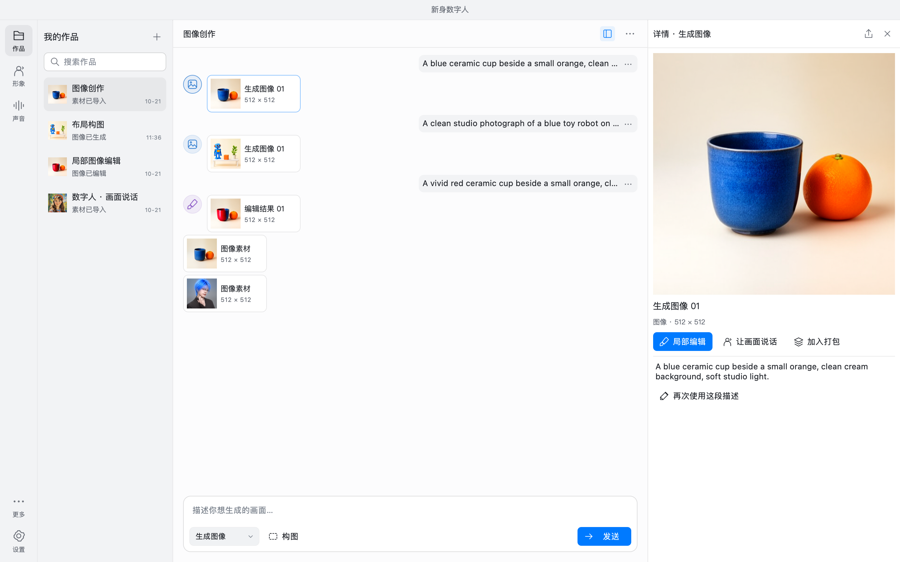
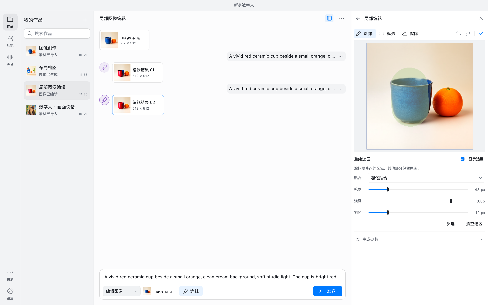
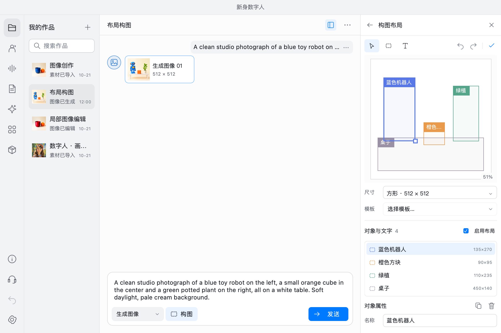
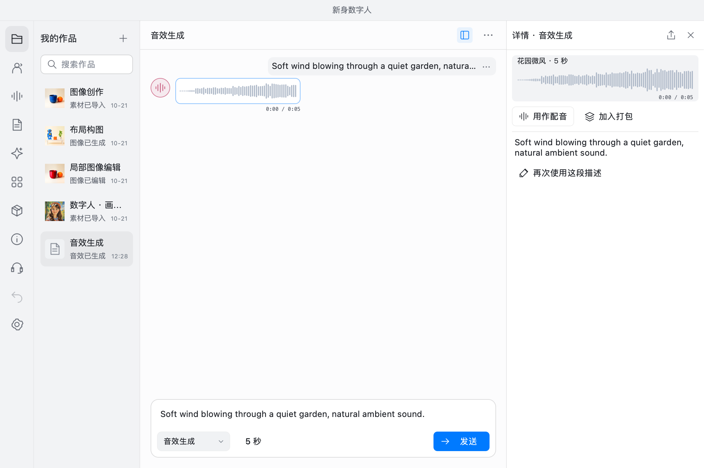
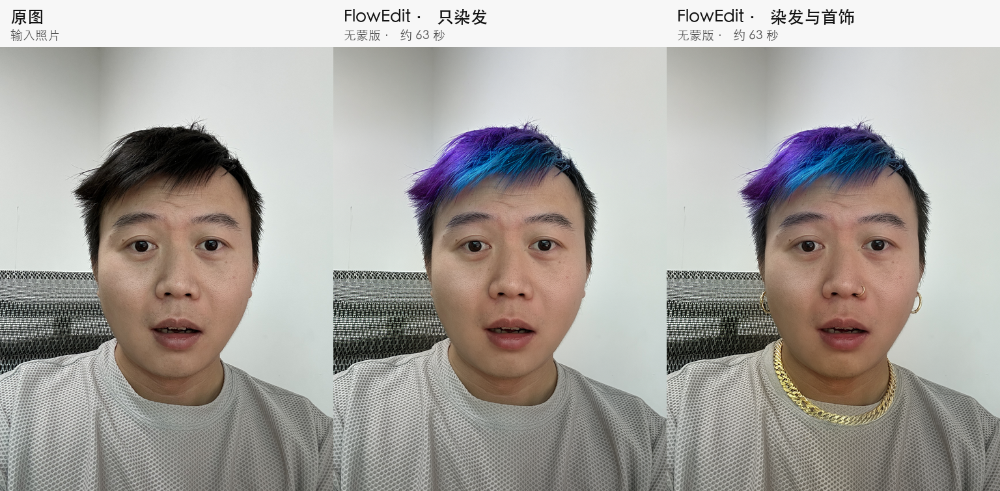
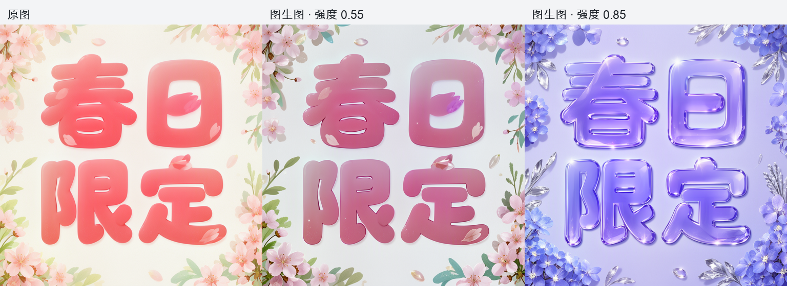
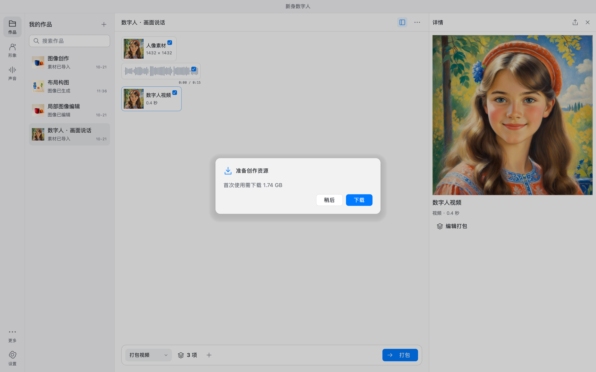
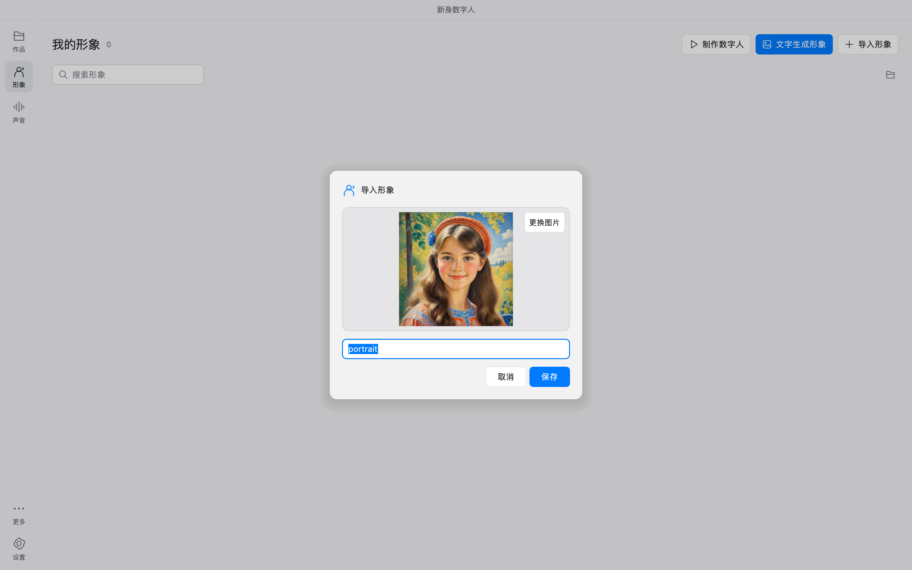

# 新身数字人 / XAvatar

**简体中文** · [English](README-en.md)

面向 Apple Silicon Mac 与 Windows x64 的本地 AI 创作 App，用对话完成图像、声音与数字人视频创作。

[**下载安装包、版本说明与校验文件**](https://github.com/425776024/MOSS-Image-Qt/releases)

macOS 支持 **Apple Silicon（M1 及后续芯片）、macOS 15+**，提供 DMG 和 App ZIP；签名与公证状态以对应发布说明为准。运行无需 Python，模型按需下载。

Windows 测试预览版支持 **Windows 10 1903+ / Windows 11、x64**，包含 Vulkan / DirectML 后端。新版提供 `XAvatar-…-Setup.exe` 单文件安装程序，安装后从桌面或开始菜单启动“新身数字人”；无需安装 Python，首次进入可多选下载资源，并引导选择创作功能。显卡完整推理及真实桌面、导出验收仍待实测。首轮测试可双击包内 `test_windows.cmd`。

`master` 为稳定主线，`dev` 为日常开发分支；两者每次推送都会自动编译两个平台。macOS 经维护者[本地一键公证发布](docs/macos-release.md#本地一键公证和发布)后更新下载目录；Windows 成功构建后自动发布。构建记录见 [macOS Actions](https://github.com/425776024/MOSS-Image-Qt/actions/workflows/macos.yml?query=branch%3Amaster+event%3Apush) 和 [Windows Actions](https://github.com/425776024/MOSS-Image-Qt/actions/workflows/windows.yml?query=branch%3Amaster+event%3Apush)；也可从成功运行的 Artifacts 下载。

## 功能预览

对话生成图像，用原图和提示词进行图生图，或涂抹局部编辑，拖动对象控制构图；设计或克隆音色，驱动人像说话，生成环境音效，再组合素材导出 MP4。

内置 17 张图片数字人形象和 21 套可编辑构图模板；图像创作默认选择下载体积更小的 Q4 版本。

| 图像创作 | 图像涂抹 | 布局构图 |
| --- | --- | --- |
|  |  |  |

| 数字人创作 | 语音设计 |
| --- | --- |
|  |  |
| **音效生成** | **视频打包** |
|  |  |

截图展示当前开发界面，已发布预览安装包可能有所不同。点击截图查看原图。[全部中文截图](assets/screenshots/zh-Hans) · [English screenshots](assets/screenshots/en)

## 图像编辑效果

### 图生图

在「编辑图像」选择「整图」，导入图片，打开「图生图」：

- **保留原貌**：填写原图描述，再在对话输入框描述修改后的完整画面。使用 FlowEdit 尽量保持人物特征与构图，无需涂抹。
- **自由重绘**：只需描述新画面，使用原有图生图方式；强度越高，变化通常越大。

选择「局部」仍可涂抹或框选需要重绘的范围。

上图是同一原图的两次独立编辑：仅染发，以及染发并添加项链、耳环和鼻环。使用原有 MOSS Q4_K 权重，768×1024、28 步、CFG 3、种子 42、强度约 0.71（20 个 FlowEdit 步骤），在 RTX 3090 上各约 63 秒。没有新增模型、蒙版或羽化贴回。此例比普通图生图更接近原貌，但肤色和细节仍会变化，不能保证人脸或框外像素完全不变。

原图描述、编辑方式和强度随作品保存；打开旧作品会保留原来的自由重绘方式。新功能需重新构建应用和图像引擎，已发布预览安装包可能尚未包含。[实现、参数与限制](vendor/moss-flowedit/README.md)。

以下为同一张原图配合“蓝紫色透明水晶字”提示词的真实推理结果：从左到右为原图、强度 0.55、强度 0.85。较高强度更明显地改变材质与花卉装饰；文字和两行构图仍可辨认。

示例使用 MOSS Q4_K、768×768、24 步在 RTX 3090 上生成，未做羽化贴回。图生图会重画整张图片，不保证文字、人物身份或其他细节不变。当前开发版已接入整图与局部范围，已发布预览安装包可能有所不同。

### 局部编辑

保留原有字形风格与背景，修改文字或选定区域。

<table>
<tr><th width="50%">中英文文字替换</th><th width="50%">人像局部改色</th></tr>
<tr>
<td align="center"></td>
<td align="center"></td>
</tr>
</table>

## 数字人效果

优化版采用 **5000 步微调、静音口型校准与起音过渡**，用于改善停顿时的嘴形与开口衔接。

**默认下载的社区／GitHub 版使用官方原版模型，对应视频左侧官方效果；最右侧优化效果需要从 App Store 下载的 App 版本才能使用。**

以下视频含声音，点击播放。

**多种形象 · 84 秒**

https://github.com/user-attachments/assets/c8c14e41-5ce8-4330-bbd6-d52f6e8f06cb

**视频人物 · 20 秒**

https://github.com/user-attachments/assets/cefbd02c-c2e2-4b03-85a7-4597a5fbbea8

[下载原始视频一](assets/showcase/avatar-demo-01.mp4) · [下载原始视频二](assets/showcase/avatar-demo-02.mp4)

## 资源与导入

按图像、数字人、语音和音效管理资源，支持按需下载、校验与清理。形象导入时直接预览图片。

| 创作资源 | 按需下载 | 形象导入预览 |
| --- | --- | --- |
|  |  |  |

## 使用的模型

| 用途 | 模型 | 功能 / 展示 |
| --- | --- | --- |
| 图像生成与编辑 | [MOSS-Image SFT GGUF](https://huggingface.co/leejet/MOSS-Image-SFT-GGUF) · Q4_K / Q8_0 | [对话创作](assets/screenshots/zh-Hans/studio.png)、[局部编辑](assets/screenshots/zh-Hans/image-edit.png)、[布局构图](assets/screenshots/zh-Hans/layout.png) |
| 图像文本编码 | [Qwen3.5-9B GGUF](https://huggingface.co/unsloth/Qwen3.5-9B-GGUF) · Q4_K_M | 理解图像描述与编辑指令 |
| 图像解码与分词 | [FLUX.2 VAE](https://huggingface.co/Comfy-Org/MOSS-Image)、[MOSS-Image tokenizer](https://huggingface.co/OpenMOSS-Team/MOSS-Image-Base) | 图像模型共用组件 |
| 数字人 | [ditto-talkinghead](https://github.com/antgroup/ditto-talkinghead) | [音频驱动人像](assets/screenshots/zh-Hans/avatar.png)、静音口型校准与起音过渡优化 |
| 人脸检测与渲染 | [YuNet](https://github.com/opencv/opencv_zoo/tree/main/models/face_detection_yunet)、[LivePortrait](https://github.com/KwaiVGI/LivePortrait) | 人脸定位、动作与画面合成 |
| 语音与音色 | [Ming-3.0 TTS 0.5B](https://github.com/inclusionAI/Ming-3.0-tts) · [GGUF Q8_0](https://huggingface.co/audio-cpp/Ming-3.0-TTS-0.5B-GGUF) | 文字配音、音色克隆、[语音设计](assets/screenshots/zh-Hans/voice-design.png)、情绪与方言控制 |
| 音效 | [Stable Audio 3 Small SFX](https://huggingface.co/thepatch/stable-audio-3-small-sfx-GGUF) · F16，配套 T5Gemma | [音效生成](assets/screenshots/zh-Hans/sfx.png)、[试听](#音效试听) |

基于 Qt / QML / C++。固定模型版本、文件摘要与来源见 [模型清单](config/models.json)。

[设计规范](DESIGN.md) · [构建与运行](docs/build.md) · [macOS 打包与公证](docs/macos-release.md) · [模型管理](docs/model-management.md) · [Ditto 模型说明](docs/ditto-default-model.md) · [第三方来源](THIRD_PARTY.md)

Windows 预览包已在 [Releases](https://github.com/425776024/MOSS-Image-Qt/releases/tag/win-0.1.0-preview.2) 提供公开下载；实机测试方式见 [Windows 构建与验收](docs/windows-release.md)。

## 许可证

原创代码采用 [MIT 许可证](LICENSE)。第三方代码、模型权重及素材保留各自许可证，来源与许可说明见 [THIRD_PARTY.md](THIRD_PARTY.md)。

## 音效试听

**花园微风 · 5 秒**，由 Stable Audio 3 Small SFX 生成。点击播放；若无声，点扬声器取消静音。

https://github.com/user-attachments/assets/1e2d898d-4a0d-4ab0-8ed0-398f7b382d06

[下载原始 WAV](assets/showcase/garden-wind-sfx.wav)
