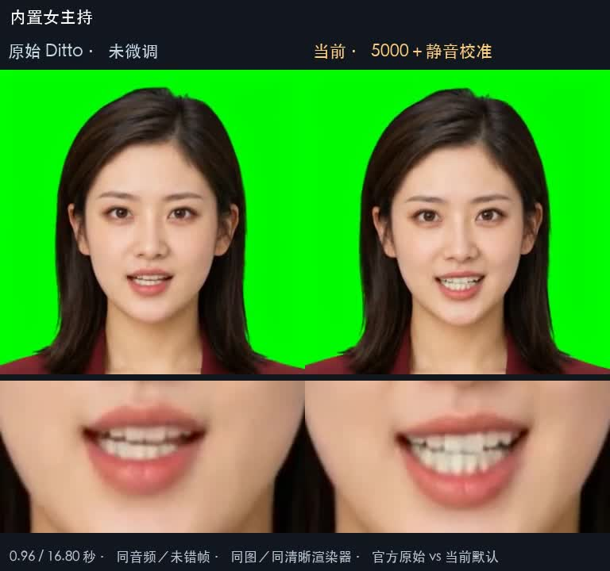
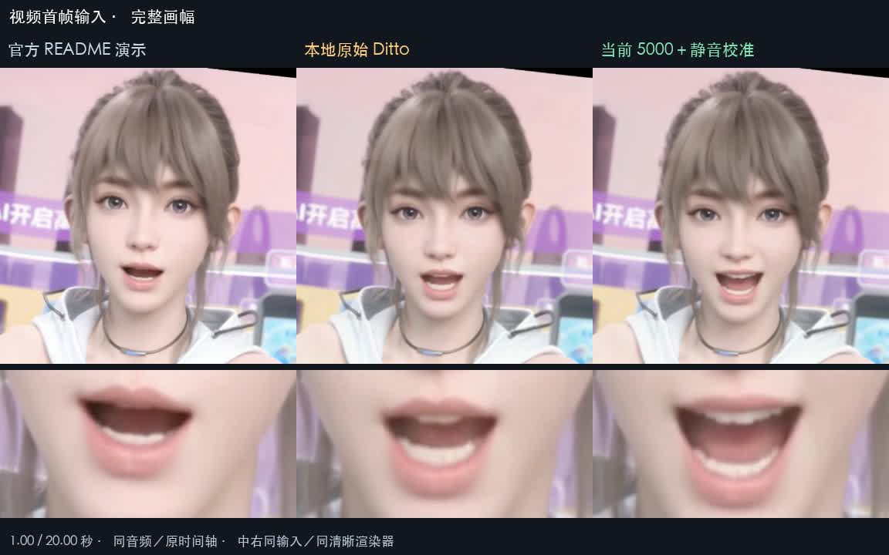

# 新身数字人 / XAvatar

[**下载 macOS 安装包（DMG）**](https://github.com/425776024/MOSS-Image-Qt/releases/download/macos-0.1.0-preview.1/Moss-Studio-0.1.0-macOS-arm64-notarized.dmg) · [App ZIP](https://github.com/425776024/MOSS-Image-Qt/releases/download/macos-0.1.0-preview.1/Moss-Studio-0.1.0-macOS-arm64-notarized.app.zip) · [版本说明与校验文件](https://github.com/425776024/MOSS-Image-Qt/releases/tag/macos-0.1.0-preview.1)

当前为 0.1.0 预览版，适用于 **Apple Silicon（M1 及后续芯片）和 macOS 15+**。
App 与 DMG 已完成 Developer ID 签名、Apple 公证并附加公证票据。打开 DMG 后将 Moss Studio 拖入 Applications；无需安装 Python，模型按需下载。

下图展示当前源码界面，预览安装包可能稍有差异。[中文截图](assets/screenshots/zh-Hans) · [English screenshots](assets/screenshots/en)

面向 Apple Silicon Mac 的本地 AI 创作 App，用对话完成图像、声音与视频创作。

## 图像编辑

涂抹需要修改的区域，调整笔刷、强度与羽化，让修改融入原图。

文字替换，保留原有字形风格与背景。

局部改色，保留选区外画面。

## 布局构图

拖动对象与文字区域，设置位置、尺寸和描述，控制画面的构图。

## 数字人

形象页可用人物描述直接生成人像，预览后保存到形象库。选择人像与配音，让画面说话；声音页支持 Ming-3.0 Q8 语音设计、音色克隆、情绪与方言朗读，也可导入音频。

口型优化对比：点击封面打开完整 MP4（含声音）。

| 内置主持形象 · 84 秒 | 视频人物 · 20 秒 |
| --- | --- |
|  |  |

## 视频打包

组合图片、视频、配音与音效，在画面和声音轨道中安排时间，导出 MP4。

## 模型管理

按图像、数字人、语音和音效管理资源，支持按需下载、校验与清理。图像可选标准或高精度。

[简洁下载提示](assets/screenshots/download.png) · [导入形象预览](assets/screenshots/avatar-import.png)

## 使用的模型

| 用途 | 模型 | 功能 / 展示 |
| --- | --- | --- |
| 图像生成与编辑 | [MOSS-Image SFT GGUF](https://huggingface.co/leejet/MOSS-Image-SFT-GGUF) · Q4_K / Q8_0 | [对话创作](assets/screenshots/studio.png)、[局部编辑](assets/screenshots/image-edit.png)、[布局构图](assets/screenshots/layout.png) |
| 图像文本编码 | [Qwen3.5-9B GGUF](https://huggingface.co/unsloth/Qwen3.5-9B-GGUF) · Q4_K_M | 理解图像描述与编辑指令 |
| 图像解码与分词 | [FLUX.2 VAE](https://huggingface.co/Comfy-Org/MOSS-Image)、[MOSS-Image tokenizer](https://huggingface.co/OpenMOSS-Team/MOSS-Image-Base) | 图像模型共用组件 |
| 数字人 | [ditto-talkinghead](https://github.com/antgroup/ditto-talkinghead) | [音频驱动人像](assets/screenshots/avatar.png)、静音口型校准与起音过渡优化 |
| 人脸检测与渲染 | [YuNet](https://github.com/opencv/opencv_zoo/tree/main/models/face_detection_yunet)、[LivePortrait](https://github.com/KwaiVGI/LivePortrait) | 人脸定位、动作与画面合成 |
| 语音与音色 | [Ming-3.0 TTS 0.5B](https://github.com/inclusionAI/Ming-3.0-tts) · [GGUF Q8_0](https://huggingface.co/audio-cpp/Ming-3.0-TTS-0.5B-GGUF) | 文字配音、音色克隆、[语音设计](assets/screenshots/voice-design.png)、情绪与方言控制 |
| 音效 | [Stable Audio 3 Small SFX](https://huggingface.co/thepatch/stable-audio-3-small-sfx-GGUF) · F16，配套 T5Gemma | 文字生成环境声与音效 |

基于 Qt / QML / C++，运行无需 Python。模型按需下载；固定版本、文件摘要与来源见 [模型清单](config/models.json)，适用许可见 [第三方来源](THIRD_PARTY.md)。

[设计规范](DESIGN.md) · [构建与运行](docs/build.md) · [macOS 自动打包与公证](docs/macos-release.md) · [模型管理](docs/model-management.md) · [Ditto 模型说明](docs/ditto-default-model.md) · [第三方来源](THIRD_PARTY.md)

## 许可证

本项目原创代码采用 [MIT 许可证](LICENSE)。第三方代码、模型权重及素材保留各自许可证，不因随本项目分发而改为 MIT；来源和许可说明见 [THIRD_PARTY.md](THIRD_PARTY.md)。
