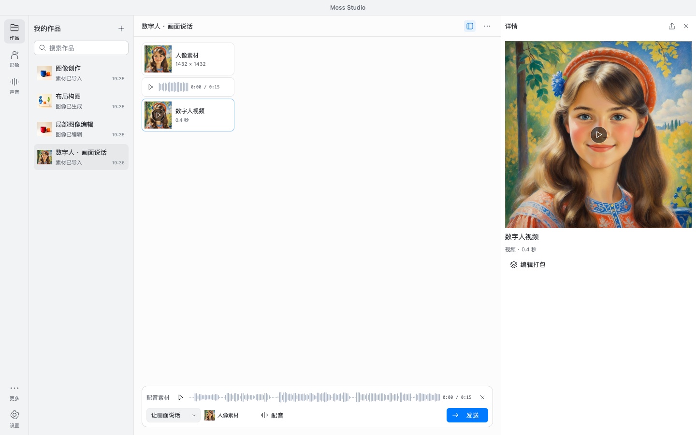
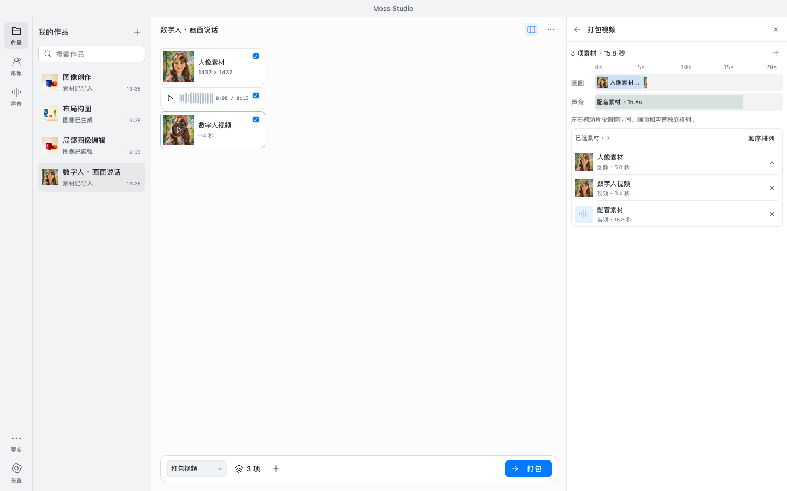
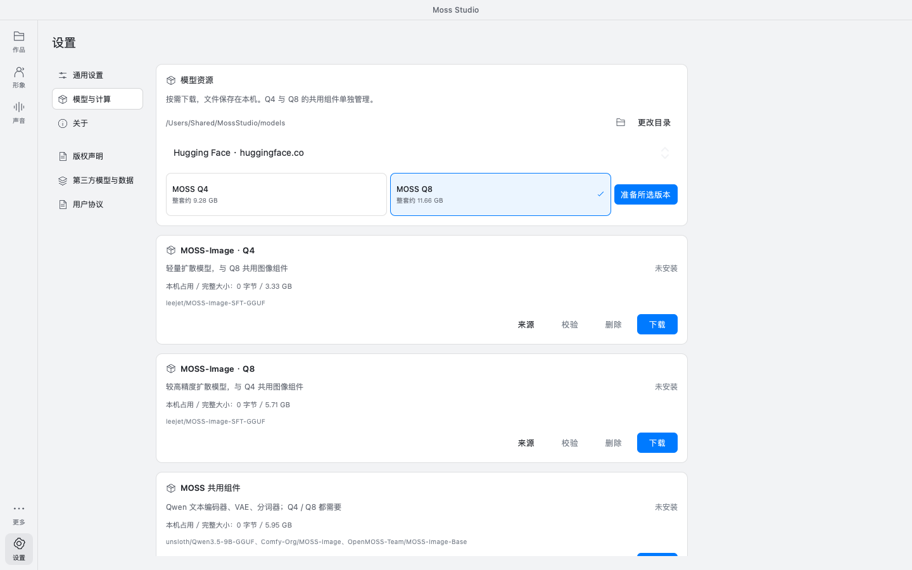

# Moss Studio

面向 Apple Silicon Mac 的本地 AI 创作 App，用对话完成图像、声音与视频创作。

## 图像编辑

涂抹需要修改的区域，调整笔刷、强度与羽化，让修改融入原图。

## 布局构图

拖动对象与文字区域，设置位置、尺寸和描述，控制画面的构图。

## 数字人

选择人像与配音，让画面说话；支持语音合成与导入音频。

## 视频打包

组合图片、视频、配音与音效，在画面和声音轨道中安排时间，导出 MP4。

## 模型管理

缺失时提示下载，支持 Hugging Face 与 [国内镜像](https://hf-mirror.com)，MOSS 可选 Q4 / Q8；支持校验、删除和清理下载残留。

基于 Qt / QML / C++，运行无需 Python。模型按需下载，Ditto 使用公开原始权重。

[构建与运行](docs/build.md) · [模型管理](docs/model-management.md) · [Ditto 模型说明](docs/ditto-default-model.md) · [第三方来源](THIRD_PARTY.md)
